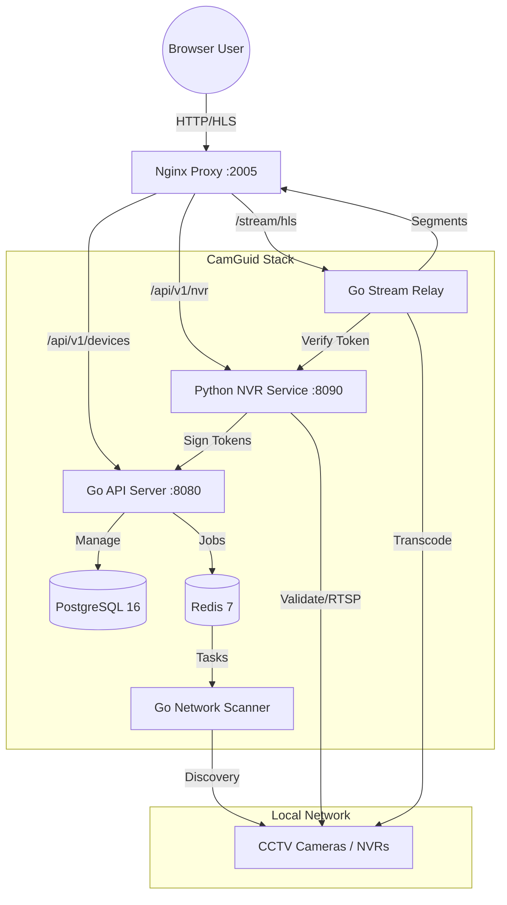

# CamGuid

CamGuid is a self-hosted, production-ready CCTV/NVR monitoring platform designed for private local networks. It combines a high-performance Go backend with a modular Python NVR integration service, featuring secure stream access and automated device discovery.

## 🚀 System Architecture & Flow

CamGuid uses a microservices architecture to separate concerns between network operations, device management, and high-bandwidth video processing.



### The "Clear Flow":
1. **Auto-Discovery**: The `scanner` service monitors the LAN, identifying RTSP/ONVIF-capable devices and reporting them to the `api`.
2. **NVR Integration**: Users manage Hikvision/Dahua/Generic NVRs through the `nvr-service`. This service handles password encryption (Fernet), RTSP URL generation, and connectivity validation via FFprobe.
3. **Secure Streaming**:
   - The user requests a signed **Stream Token** (HMAC-SHA256) from the API.
   - The `relay` service validates the token before initiating an FFmpeg transcode session.
   - Raw RTSP credentials are **never exposed** to the browser.
4. **HLS Delivery**: `nginx` serves low-latency HLS segments directly from shared memory volumes for smooth playback.

---

## 🛠️ Services

| Service | Technology | Responsibility |
|---------|------------|----------------|
| `nginx` | Nginx 1.25 | SSL Termination, Load Balancing, HLS Static File Serving |
| `api` | Go / Fiber | User Auth, Device Metadata, Audit Logs, Orchestration |
| `nvr-service`| Python / FastAPI | Vendor Strategy (Hikvision/Dahua), FFprobe Validation, Token Signing |
| `scanner` | Go | High-speed LAN scanning (ARP/Port/ONVIF) |
| `relay` | Go | RTSP to HLS Transcoding Management |
| `db` | PostgreSQL 16| Persistent storage for users, devices, and NVR configs |
| `redis` | Redis 7 | Task queues, Real-time status, Pub/Sub |

---

## ⚡ Quick Start

### 1. Prerequisites
- Docker Engine 24+
- Docker Compose v2

### 2. Create `.env`
Initialize your environment variables. A 64-character hex `ENCRYPTION_KEY` is required for NVR password security.

```dotenv
# Database
DB_PASSWORD=camguid

# Security
JWT_SECRET=super_secret_jwt_key_12345
ENCRYPTION_KEY=0123456789abcdef0123456789abcdef0123456789abcdef0123456789abcdef
NVR_STREAM_SIGNING_SECRET=camguid-nvr-stream-signing-secret-2026

# Configuration
LOG_LEVEL=info
SCANNER_TIMEOUT=60
```

### 3. Deploy
```bash
docker compose up --build -d
```

### 4. Default Credentials
The system initializes with a default administrator on first boot:
- **URL**: `http://localhost:2005`
- **Username**: `admin`
- **Password**: `admin`
- **DB Password**: `camguid`

---

## 📖 Development Commands

```bash
# Force rebuild and restart
docker compose down -v && docker compose up --build -d

# Monitor NVR Service logs
docker compose logs -f nvr-service

# Run NVR Integration tests
cd nvr-service && pytest
```

## 📂 Project Structure
```text
camguid/
├── docker-compose.yml   # Full stack orchestration
├── backend/             # Go microservices (api, scanner, relay)
├── nvr-service/         # Python NVR integration module
├── frontend/            # React/Vite dashboard
├── nginx/               # Proxy & Routing config
└── scripts/             # Deployment & Maintenance utilities
```
