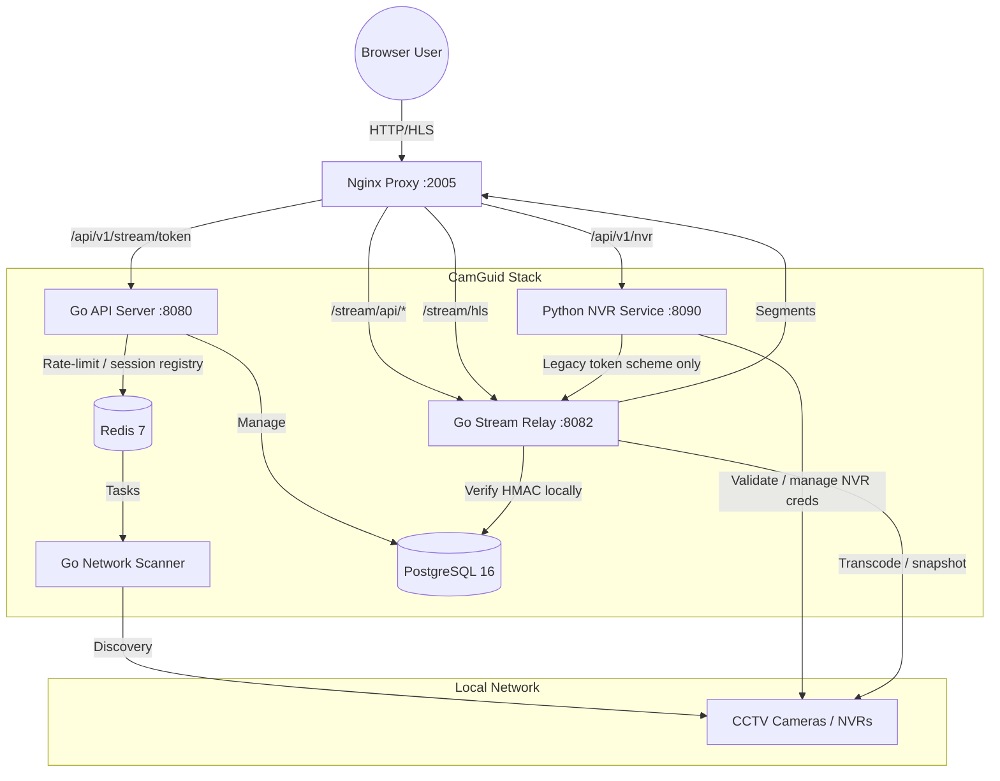

# CamGuid

CamGuid is a self-hosted, production-ready CCTV/NVR monitoring platform designed for private local networks. It combines a high-performance Go backend with a modular Python NVR integration service, featuring secure stream access and automated device discovery.

## 🚀 System Architecture & Flow

CamGuid uses a microservices architecture to separate concerns between network operations, device management, and high-bandwidth video processing.



### The "Clear Flow":
1. **Auto-Discovery**: The `scanner` service monitors the LAN, identifying RTSP/ONVIF-capable devices and reporting them to the `api`.
2. **NVR Integration**: Users manage Hikvision/Dahua/Generic NVRs through the `nvr-service`. This service handles password encryption (Fernet), RTSP URL generation, and connectivity validation via FFprobe. Its stream-token endpoints are retained as legacy only — see Security.
3. **Secure Streaming**:
   - The user requests a **device-bound Stream Token** (`POST /api/v1/stream/token`) from the API. The token is an HMAC-SHA256 signed, ~5-minute expiring payload containing the device id and the requesting user id.
   - The `relay` verifies the token **fully locally** (HMAC + PostgreSQL device lookup via `ResolveStreamURL`) before initiating an FFmpeg transcode session. No token round-trip to another service and no raw RTSP URLs ever reach the browser, the frontend, or the relay's HTTP interface.
   - Stream URLs are **encrypted at rest** (AES-256-GCM, `enc1:` prefix) and never serialized in API responses (`stream_configured` reports presence only).
4. **HLS Delivery**: `nginx` serves low-latency HLS segments directly from shared memory volumes for smooth playback.

---

## 🛠️ Services

| Service | Technology | Responsibility |
|---------|------------|----------------|
| `nginx` | Nginx 1.25 | SSL Termination, Load Balancing, HLS Static File Serving |
| `api` | Go / Fiber | User Auth, Device Metadata, Audit Logs, Orchestration |
| `nvr-service`| Python / FastAPI | Vendor Strategy (Hikvision/Dahua), FFprobe Validation, Token Signing |
| `scanner` | Go | High-speed LAN scanning (ARP/Port/ONVIF) |
| `relay` | Go | RTSP to HLS Transcoding Management |
| `db` | PostgreSQL 16| Persistent storage for users, devices, and NVR configs |
| `redis` | Redis 7 | Task queues, Real-time status, Pub/Sub |

---

## ⚡ Quick Start

### 1. Prerequisites
- Docker Engine 24+
- Docker Compose v2

### 2. Generate secrets
Copy `.env.example` and fill it — never commit real secrets. The bundled generator produces cryptographically random values and validates them:

```bash
cp .env.example .env
scripts/generate-secrets.sh            # fills .env with random secrets
docker compose config                  # fails fast on missing/placeholder secrets
```

Secrets required:
| Variable | Requirement |
|----------|-------------|
| `DB_PASSWORD` | Postgres password |
| `JWT_SECRET` | API access-token HMAC key (long random string) |
| `ENCRYPTION_KEY` | **64 hex chars** — AES-256-GCM key for device `stream_url` at rest |
| `CAMGUID_STREAM_SIGNING_SECRET` | HMAC key for device-bound stream tokens |
| `NVR_ENCRYPTION_KEY` | **44-char base64 Fernet key** for NVR credentials |
| `NVR_STREAM_SIGNING_SECRET` | nvr-service legacy stream-token HMAC key |
| `BOOTSTRAP_ADMIN_PASSWORD` | Optional — override the one-time random admin password |

The API, relay, and scanner refuse to boot with placeholder or missing secrets (`CHANGE_ME`/`changeme`/`example`/`super_secret`, etc.).

### 3. Deploy
```bash
docker compose up --build -d
```

### 4. Default Credentials
The system initializes with a single **bootstrap administrator** on first boot:
- **URL**: `http://localhost:2005`
- **Username**: `admin`
- **Password**: 
  - Set `BOOTSTRAP_ADMIN_PASSWORD` in `.env` **or** read the one-time random password from `docker compose logs api` (`Generated one-time bootstrap admin password`).
- The bootstrap admin is flagged `must_change_password=true` — the UI forces a new password before allowing any other action.

---

## 🔐 Security (TLS & Hardening)

- **TLS is deployer-managed.** CamGuid ships HTTP-only internally. Terminate TLS at a reverse proxy (Caddy, Traefik, or nginx with a Let's Encrypt/Nginx Proxy Manager cert) in front of `:2005`. Do not expose the API/scanner/relay ports directly.
- **Network model**: nginx → api/relay/nvr-service are on one Docker network; `http://localhost:2005` is the only externally mapped port. The scanner runs with `network_mode: host` and needs Docker `NET_RAW`/`NET_ADMIN` for ARP ping sweeps — do not expose it publicly.
- **Authentication & RBAC**: JWT access tokens (15 min) + refresh tokens (7 days). Roles: `admin`, `operator`, `viewer`. Device mutations, scan center, and audit logs are admin/operator-only; viewers get read-only dashboards. Login is rate-limited per IP+username (Redis).
- **Stream access**: device-bound HMAC stream tokens (5 min TTL) are minted only for authenticated users; the relay verifies them locally and resolves the stream URL from PostgreSQL. Raw RTSP URLs are never sent to clients.
- **Data at rest**: device `stream_url`/`secondary_url` are AES-256-GCM encrypted; NVR credentials use Fernet. Passwords use bcrypt.
- **Audit trail**: logins, registrations, password changes, and device mutations write to `audit_logs` (actor/result/detail) with an admin/operator CSV export. Retention via `CAMGUID_AUDIT_RETENTION_DAYS` (default 90).
- **Secrets**: all services validate config on startup and refuse placeholder values. See `SECURITY.md`.

---

## 📖 Development Commands

```bash
# Force rebuild and restart
docker compose down -v && docker compose up --build -d

# Monitor NVR Service logs
docker compose logs -f nvr-service

# Run NVR Integration tests
cd nvr-service && .venv/bin/python -m pytest

# Run backend tests
cd backend && go build ./... && go vet ./... && go test -race ./...

# Build the frontend
cd frontend && npm ci && npm run build

# CI smoke test (docker compose stack)
scripts/ci/smoke-test.sh
```

## 📂 Project Structure
```text
camguid/
├── docker-compose.yml   # Full stack orchestration
├── backend/             # Go microservices (api, scanner, relay)
├── nvr-service/         # Python NVR integration module
├── frontend/            # React/Vite dashboard
├── nginx/               # Proxy & Routing config
├── scripts/             # Deployment, secret generation & CI utilities
└── .github/workflows/   # CI pipeline (vet, race tests, pytest, build, smoke)
```
